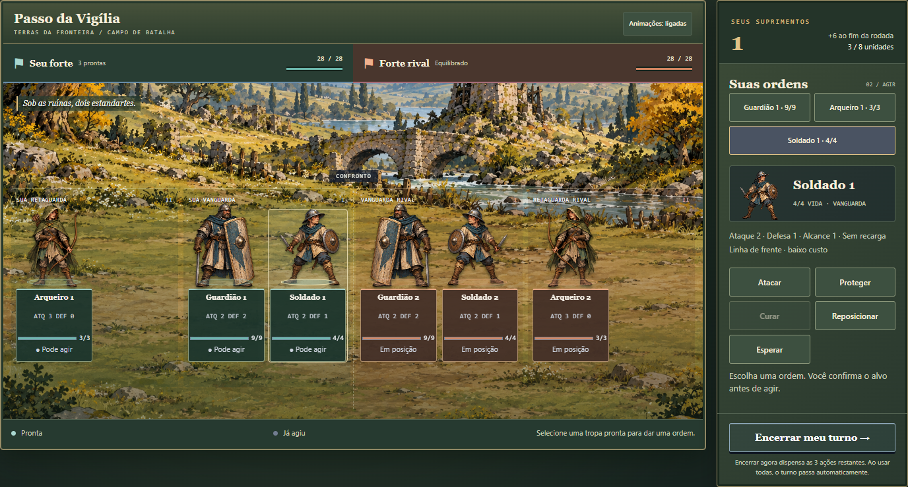

# Tactical Auto-Battler

[](https://github.com/enzo-going/tactical-autobattler-python/actions/workflows/tests.yml)
[](https://github.com/enzo-going/tactical-autobattler-python/actions/workflows/pages.yml)

Um pequeno jogo tático em turnos feito em Python. Recrute um esquadrão, forme a
linha e abra caminho até o forte adversário. As tropas ficam de pé no campo, em
vanguarda e retaguarda, cada função com arte própria.

**[Jogar no navegador](https://enzo-going.github.io/tactical-autobattler-python/)** ·
[Laboratório de simulação](https://enzo-going.github.io/tactical-autobattler-python/simulator.html) ·
[A transição para a fase II](docs/phase-two.md)

> A versão publicada acompanha `main`. Mudanças em uma branch/PR só aparecem
> no site após merge e conclusão do workflow Pages. Para testar uma branch,
> siga as instruções locais abaixo.



<sub>Captura da interface real da versão 0.11. A arte e os comandos exibidos fazem parte do jogo.</sub>

## Seu exército, seu turno — 0.11

O modo principal agora apresenta **Crônicas da Fronteira**. Dê todas as ordens
do seu esquadrão antes de assistir ao turno completo do rival. A última ação
passa a vez automaticamente; **Encerrar meu turno** dispensa as restantes.
O rival aparece agindo uma tropa por vez, com destaque de origem e alvo,
impacto e baixas. Escolha 1×/2× ou conclua sem animações. Recarregar durante a
resposta rival retoma os comandos aceitos sem duplicar ataques.

O campo e as seis tropas receberam uma primeira arte ilustrada, combinando
exércitos medievais e personagens expressivos. O laboratório mantém seu
elenco vetorial. Os arquivos do jogo são servidos com o próprio site.

A [nova direção](docs/nova-direcao.md) registra referências, estudo visual,
medições e próximos passos: terrenos, cartas de ordem, montagem de tropas e
missões. Esses sistemas ainda não estão implementados. A troca de turnos
sozinha não encurtou as partidas; a duração continua em revisão.

Salvamentos desta versão usam tactical-v6. Cópias antigas são preservadas,
mas precisam da versão que as criou para continuar.

## Capítulo II — sob seu comando

Na versão 0.2, a interface calculava a partida inteira e apresentava um replay.
O jogador escolhia duas estratégias e assistia. A versão **0.3** retoma a ideia
de um jogo por turnos: a partida existe como uma sessão em Python e espera por
uma ordem a cada decisão. Nenhum cronômetro avança o campo.

| Antes: simulador | Agora: modo principal |
| --- | --- |
| Escolher dois bots | Comandar um esquadrão contra um bot |
| Assistir à sequência pronta | Escolher unidade, ação e alvo |
| Recrutamento automático | Comprar reforços e decidir a linha |
| Cura e proteção automáticas | Decidir quando atacar, curar ou proteger |
| Play, pause e velocidade | Preparação, turnos completos e revisão |
| Relatório de uma simulação | Histórico de comandos e estado da partida |

O laboratório continua disponível com simulações, replays e torneios. Os dois
modos compartilham alcance por fileiras e recarga; diferem em alternância,
recrutamento e ordens automáticas. Seus resultados medem balanceamentos distintos.

A [documentação da fase II](docs/phase-two.md) registra decisões de arquitetura,
diferenças de regras, contrato de comandos e processo de migração.

## Continue a expedição — 0.10

A partida é salva neste navegador após cada ordem aceita. Feche a aba ou
recarregue: a preparação, o combate ou o resultado voltam no mesmo ponto.
O aviso acima do campo informa se o salvamento está disponível.

Use **Salvar partida / relatório** para baixar uma cópia JSON e **Carregar
partida** para retomá-la em outro navegador. Na 0.10, relatórios interativos da 0.9
(`tactical-v5`) também funcionavam; a 0.11 usa regras novas (`tactical-v6`). O Python reproduz as decisões e valida o
resultado antes de substituir a partida atual. Arquivos de outro modo ou
outras regras são recusados. Limites: 2 MB e 2000 comandos por arquivo.

As fichas da loja agora mostram vida, ataque, defesa e alcance sem depender de
passar o mouse. No combate, escolha outra tropa pronta diretamente no painel
de ordens e cancele a seleção de alvo sem gastar a ação.

## O Médico que salva — 0.9

- **Triagem.** O Médico trata um aliado por ação, todas as rodadas: cura 3,
  estanca o sangramento e desfaz o atordoamento.
- **Vale para quem sangra.** Um aliado sangrando ou atordoado pode ser tratado
  mesmo com a vida cheia, e a confirmação mostra o que será removido.

Antes, investir no Médico era a pior compra do jogo. Dez funções foram medidas
antes da escolha — curar em área rendeu menos do que curar um. O preço é ritmo:
curar prolonga o combate. Os números estão em [Médico: triagem](docs/triagem.md).

## A linha decide o fim — 0.8

- **Linha rompida.** Sem ninguém vivo na vanguarda rival, a sua vanguarda pode
  atacar o forte. A retaguarda rival continua defendendo, ao alcance da sua.
- **Dano excedente.** O golpe que derruba uma tropa leva ao forte o que sobrar
  depois de defesa e escudo. A confirmação mostra quanto chega.
- **A tela avisa.** A faixa de vanguarda vazia vira aviso: linha rival rompida,
  ou o seu forte exposto — já na preparação.

Antes, 9 em cada 10 partidas terminavam no desempate, porque o forte só
apanhava com o campo vazio. Agora metade termina com um forte destruído. Os
números, o método e o que a regra ainda não resolve estão em
[Ritmo: linha rompida e dano excedente](docs/ritmo.md).

## Decisões mais claras — 0.7

- **Monte e revise.** Selecione tropas no campo para trocar de linha gratuitamente
  na preparação. Devolva recrutas recém-comprados pelo custo integral; veteranos
  mantêm vida e efeitos e não podem ser vendidos.
- **Compare antes de atacar.** Os alvos mostram dano imediato, vida restante,
  golpe final e efeitos. Defesa e escudo entram no cálculo do próprio motor.
- **O rival aproveita a vez.** Avança quando está sem alcance, usa proteção
  durante a recarga e pode salvar aliados de um golpe fatal. A comparação com
  a versão anterior está em [Jogabilidade e medição](docs/gameplay.md).

## Como jogar

1. **Prepare.** Comece com 10 suprimentos e recrute até 8 unidades. Escolha a
   vanguarda ou a retaguarda, ou mantenha a posição recomendada.
2. **Dê ordens.** Entre em combate, selecione uma unidade pronta, escolha uma
   ação e confirme o alvo. O rival aguarda você concluir todas as suas ordens. Cada peça age
   uma vez por rodada, inclusive os recrutas recém-chegados.
3. **Reorganize.** Quando todas as unidades agirem, confira o resultado da
   rodada. Se a partida continuar, ambos recebem 6 suprimentos e o jogo espera
   você avançar.
4. **Vença.** Derrube a vanguarda rival: com a linha rompida, a sua vanguarda
   pode atacar o forte. O golpe que derruba uma tropa leva o excedente ao forte.
   Destruir o forte vence a partida. No limite de rodadas, vence a base com mais
   vida; em igualdade, conta o dano de golpes causado (sem sangramento).
   Persistindo a igualdade, há empate.

| Unidade | Custo | Alcance | Recarga | O que oferece |
| --- | ---: | :---: | :---: | --- |
| Soldado | 2 | 1 | — | Linha de frente barata |
| Arqueiro | 3 | 2 | — | Atinge de longe e causa sangramento |
| Guardião | 4 | 1 | — | Resiste a golpes e pode proteger um aliado |
| Médico | 5 | 2 | — | Triagem: cura 3, estanca sangramento e desfaz atordoamento |
| Tanque | 5 | 1 | 1 rodada | Golpe pesado que atordoa o alvo |
| Lanceiro | 4 | 2 | — | Golpeia a vanguarda rival sem sair da retaguarda |

Todas as peças podem atacar, proteger a si mesmas, trocar de linha ou esperar.
Cada ordem consome a ação.

O alcance é contado **em fileiras, a partir de onde a tropa está**: frente
contra frente é 1, fundo contra frente é 2, e fundo contra fundo é 3. Se um lado
não tem vanguarda viva, sua retaguarda conta como frente para medir a distância,
sem mudar a posição de recrutamento. Reforçar a vanguarda volta a proteger o fundo.

Uma arma de alcance 1 atrás de aliados na frente precisa avançar para atingir
as tropas rivais. No jogo você dá a ordem **Reposicionar**; no laboratório o
avanço é automático e gasta a ação. Armas de alcance 2 podem atingir o fundo
rival quando estão na própria frente, ou a frente rival quando estão atrás.

Cada arma também tem a sua **cadência**. O martelo do Tanque gasta a rodada
seguinte recarregando — nessa rodada ele ainda pode proteger, reposicionar ou
esperar, mas não golpear. Por isso o esquadrão rende mais quando mistura
cadências: enquanto o martelo recarrega, a linha de frente sustenta o dano, e a
triagem do Médico trata quem apanhou.

É a formação e o tempo, e não só a ficha da unidade, que decidem a batalha.

Na escaramuça interativa, você começa todas as rodadas, seguido do rival.
A seed continua definindo as decisões aleatórias do bot.
Os estilos rivais mudam as compras. Durante o combate, todos usam a mesma
heurística: unidade mais rápida disponível, golpe que vence a partida, golpe
final quando possível, cura, proteção contra golpe fatal e ataque ao alvo
alcançável com menos vida. Sem
ataque, pode avançar ou se proteger. Você escolhe a ordem de suas peças.

## Rodar localmente

Requer **Python 3.10+**. O pacote de jogo usa somente a biblioteca padrão.

```bash
python tools/build_site.py
python -m http.server 8765 --bind 127.0.0.1 --directory _site
```

Abra [localhost:8765](http://localhost:8765). Refaça o build depois de editar os
fontes. Abrir `web/index.html` diretamente como arquivo não funciona: os módulos
Python precisam ser servidos por HTTP.

O navegador carrega Python por [Pyodide](https://pyodide.org/), via CDN, na
primeira visita. Isso exige conexão. A partida roda localmente na aba, sem
backend, conta ou envio das decisões a um servidor.

## Interface

O campo usa verde oliva, tons de terra, fontes do sistema e silhuetas em SVG.
A abertura recolhe ao entrar em combate para dar espaço ao tabuleiro. Abaixo de
800 pixels, os comandos ficam sob o campo; em telas pequenas, as peças se
organizam em duas colunas. Alvos também aparecem como botões no painel, sem
depender de arrastar peças, hover ou precisão do mouse.

Há foco de teclado visível, rótulos de vida e ações, avisos de turno anunciados
por leitores de tela, manual e preferência de movimento reduzido. O diário
mostra os seis eventos mais recentes e permite abrir todo o histórico.

## Arquitetura Python / POO

```text
battle_simulator/
  models.py       # Base, Troop, subclasses, efeitos, linhas e fábrica
  engine.py       # Motor automático, dano, eventos e snapshots
  session.py      # Sessão interativa: fases, comandos e ações válidas
  strategies.py   # Políticas de compra e planos dos bots
  tournament.py   # Confrontos e métricas do laboratório
  cli.py          # Simulador, modo textual histórico e exportação
web/
  index.html      # Jogo principal
  game.js         # Controles, apresentação e tradução dos eventos
  game.css        # Tabuleiro e interface responsiva
  playground.py   # Ponte JSON entre navegador e pacote Python
  simulator.html  # Laboratório preservado
  app.js          # Replays e torneios
  style.css       # Estilos do laboratório
tools/
  build_site.py   # Mesmo build local e no GitHub Pages
tests/
  test_engine.py  # Regressões do simulador
  test_session.py # Regras e comandos do jogo interativo
  browser_smoke.py # Verificação opcional com navegador real
```

`TacticalSession` compõe `BattleEngine` e os objetos de domínio existentes.
A interface recebe estado, eventos e ações válidas; não calcula dano, alcance,
recursos ou vitória em JavaScript. Identificadores são em inglês; interface e
documentação estão em pt-BR.

## Simulador e linha de comando

Os comandos anteriores continuam funcionando:

```bash
python -m battle_simulator --mode auto --strategy-one aggressive --strategy-two defensive --rounds 20 --seed 11
python -m battle_simulator --mode tournament --simulations 20 --rounds 30 --seeds 3,7,11 --summary-only
python -m battle_simulator --mode auto --quiet --report-json reports/battle.json
python -m battle_simulator --list-strategies
python -m battle_simulator --mode interactive --rounds 20
```

O último comando é a interface textual **histórica** do simulador. O novo ciclo
de ações alternadas está na interface web e na API Python `TacticalSession`.
Não foi feita uma migração silenciosa das regras da CLI.

Instalação opcional dos comandos `tactical-autobattler` e `battle-simulator`:

```bash
python -m pip install -e .
```

Para instalar uma cópia sem vínculo com os fontes, use `python -m pip install .`.
Só o pacote `battle_simulator` é instalado; a interface web e os scripts
históricos permanecem no repositório.

## Testes

```bash
python -m unittest discover -s tests
python -m compileall battle_simulator tests web/playground.py tools
node --check web/game.js
node --check web/app.js
node --check web/characters.js
node --check web/replay-state.js
node --test tests/replay.test.cjs
```

Node executa as verificações de JavaScript e compara o replay com snapshots
do motor Python, inclusive depois de buscar outra posição na linha do tempo.
O CI verifica Python 3.10 e 3.12, incluindo a instalação e a execução dos
comandos de console fora da pasta dos fontes.
Os testes Python cobrem modos anteriores, comandos inválidos, custos, limite
de esquadrão, alcance, alvos estáveis, habilidades, efeitos, renda, desempate,
fim de partida e reprodução determinística do histórico.

O CI também joga uma partida real em Chromium. Para executar localmente:

```bash
python -m pip install playwright==1.63.0
python tools/build_site.py
python tests/browser_smoke.py
```

Por padrão usa Edge instalado. Para Chromium, execute
`python -m playwright install chromium` e defina `BROWSER_CHANNEL=chromium`
no ambiente. Ele percorre uma partida real com Pyodide, exportação, reinício,
seis larguras de tela, ações no celular e o laboratório. Playwright é uma
dependência de desenvolvimento, não do jogo. O script abre e encerra seu próprio
servidor; `SITE_URL` permite verificar uma publicação existente. Capturas e
relatório ficam em `_site/qa` e nos artefatos do CI.

## Limites desta versão

- O salvamento é local a este navegador e endereço; limpar seus dados pode
  apagá-lo. Não há sincronização entre dispositivos. Baixe uma cópia para
  transportar ou guardar a partida. Evite jogar a mesma partida em várias abas.
- Salvamentos de regras antigas não são migrados. Uma cópia local incompatível
  permanece disponível para download até você escolher substituí-la.
- Se o navegador bloquear o armazenamento, o jogo avisa e continua funcionando;
  nesse caso, use a exportação manual antes de sair.
- O mapa tem duas linhas por lado, sem deslocamento em grid.
- Ainda não há campanha, multiplayer, áudio ou progressão persistente.
- O equilíbrio interativo precisa de playtests; métricas antigas de torneio
  não validam automaticamente as novas regras.

## Histórico e próximos passos

O projeto começou como exercício acadêmico de POO. Os scripts originais estão
em `legacy/`. A primeira reorganização criou o simulador com bots, testes e
torneios. A fase atual transforma essa base em um jogo controlado pelo jogador.

[Transição para a fase II](docs/phase-two.md) · [Changelog](CHANGELOG.md) ·
[Roadmap](docs/roadmap.md) · [Contexto acadêmico](docs/academic_context.md) ·
[Contribuição](CONTRIBUTING.md)
